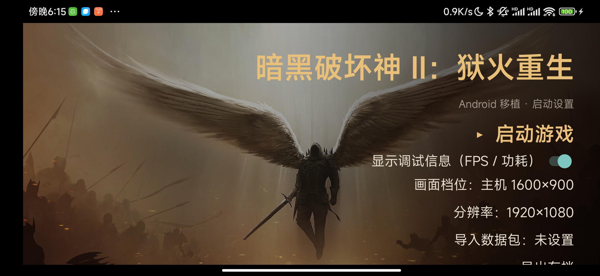
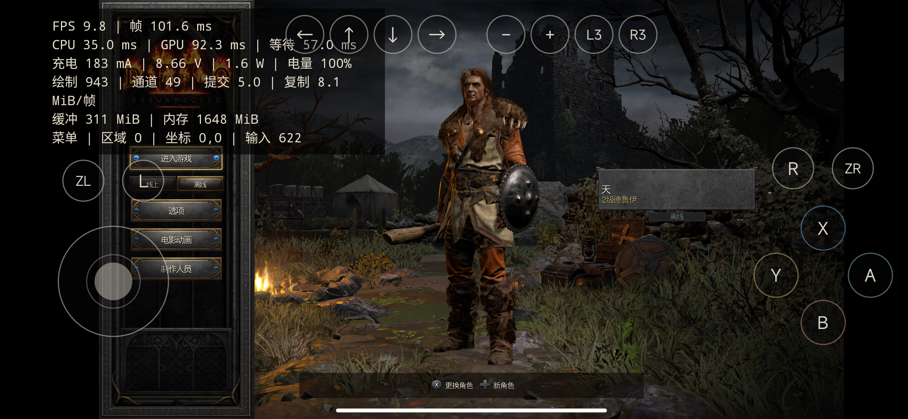

# d2r-android —— 把《暗黑破坏神 II：狱火重生》跑在安卓手机上/平板上

把 **Switch 版**《暗黑破坏神 II：狱火重生》（含"术士君临"资料片）用**你自己买的正版介质**跑起来：
原生执行原版 ARM64 代码，截获 NVN 并自己实现 Vulkan 后端，触屏操作，不需要模拟器。

**你必须拥有正版游戏。** 本仓库**不提供、也不会提供**任何游戏内容、密钥或解密工具。

---

## 〇、致谢与来源（先看这段）

这个项目没有白手起家，站在两个公开项目肩上：

| 项目 | 作用 | 许可 |
| --- | --- | --- |
| **[jhaizhou-ops/d2r-mobile](https://github.com/jhaizhou-ops/d2r-mobile)** | **本项目最初的灵感来源**。它实现了 iPhone / iPad / Mac / Android / 鸿蒙 上的兼容层（NVN → Metal），触屏操作、60 帧、秘境模式都在里面。本项目的宿主代码、NVN 截获思路、触屏与手柄框架都源自它 | MIT |
| **[sydeEvans/d2r-android](https://github.com/sydeEvans/d2r-android)** | 把 d2r-mobile 移植到安卓的版本。**本仓库的 `upstream/` 就是它的快照**（`5d8e322`），安卓端的手柄接管、帧率档、崩溃落盘等改动在它之上 | MIT |
| **[Eden](https://git.eden-emu.dev/eden-emu/eden)** | Switch 模拟器。**只作参考**：它的异步调度、完成序号、上传缓冲池、Android 驱动装载是本项目 Vulkan 后端的设计参照。**它的着色器翻译是 GPL-3.0，没有并入本 MIT 项目** | GPL-3.0（仅参考） |
| **[Mesa / Turnip](https://gitlab.freedesktop.org/mesa/mesa)** | 随包分发的开源 Vulkan 驱动（T30 Adreno 构建，作者 [@Mr_Purple_666](https://gitlab.freedesktop.org/mesa/mesa)），MIT，原样放在 `upstream/dm/android/prebuilt/turnip/` | MIT |

**没有这两个仓库，本项目不会存在。** 再次致谢 jhaizhou 与 sydeEvans。

---

## 一、结论先行：两台设备实测通过

| 设备 | GPU / 系统 | 实测结果 |
| --- | --- | --- |
| **小米 25079RPDCC 平板** | **Mali-G925-Immortalis MC12**（天玑）· Android 16 · 3008×1880 · 无 root | 完整流程跑通：导入数据包 → 启动 → 主菜单 → 角色选择 → **营地正常渲染**。营地 1600×900，画面亮度与 Adreno 同场景一致（场景区平均 sRGB 45.4，Adreno 参考 43.4，纯黑像素 0%） |
| **小米 M2007J1SC 手机** | 骁龙 865 · **Adreno 650** · Android 12 | 完整流程跑通。1080p 约 10 fps、720p 约 17 fps；60 秒连续运行 `FATAL=0` `CRASH=0` |

> Mali 那台平板上曾出现"3D 场景近乎全黑、界面却完全正常"的怪问题，根因是**为绕开 Mali 驱动崩溃而做的
> LocalSize Z 折叠，让着色器自己手算的 z 索引失配**，一半 z 切片永远不写。已修，详见 [§五](#五mali-上的坑折叠让着色器手算的索引失配)。

---

## 二、仓库里有什么，怎么跑起来

### 产线是两步

```
  上游 build.py  ──►  D2R-Android-port.apk        阶段一：上游打出来的原版 APK
       （Linux-only，Windows 见 docs/BUILD_ON_WINDOWS.md）
                        │
                        │  adapt/patch-apk.py
                        │  · 删 assets/turnip/
                        │  · 注入 6 个 Adreno 840 驱动文件
                        │  · libdmandroid.so 里等长改名 libvulkan.so → libd2rvlk.so
                        ▼
                  patched-unsigned.apk
                        │  adapt/zipalign.py
                        │  adapt/patch-apk.py 之后再对齐
                        ▼
                  patched-aligned.apk
                        │  apksigner（用仓库里的 d2r-debug.keystore）
                        ▼
  ▶  成品 APK（Adreno 路线）                    可直接装
```

**Adreno 650 这条路需要 6 个高通的专有二进制**（`drivers/Qualcomm_840/`）。
它们**没有、也不会**随本仓库分发（专有二进制，无再分发授权），
请自行准备后放进该目录 —— 详见 [`drivers/Qualcomm_840/README.md`](drivers/Qualcomm_840/README.md)。
仓库里带的是**上游基线 APK**（阶段一的输入，不含任何专有内容），没有 Linux 机器也能往下走。

### 手机侧还需要什么

| 项 | 说明 |
| --- | --- |
| 成品 APK | 用上面的产线做出；**Mali 设备不需要专有驱动**，用随包分发的 Turnip 或系统驱动 |
| Magisk 模块 | `adapt/magisk-d2r-bind/` —— 只做 bind mount，跟驱动无关，见 [§五](#五仍然必须保留的-magisk-模块) |
| 数据包 | 8.8 GB 正版数据，**不在本仓库**（本仓库明确禁止分发游戏内容），自行从正版介质导入 |
| 锁竖屏 | 转屏会让进程静默退出，见 [§七](#七已知限制) |

### 目录一览

```
.
├── README.md               本文件
├── UPSTREAM.md             上游来源、commit、以及「上游被改了什么」的对照
├── THIRD-PARTY-NOTICES.md  第三方许可与出处（Turnip / AdrenoTools / Eden / Ryujinx / …）
├── LICENSE                 MIT 许可
├── upstream/               d2r-android 源码快照 + 本项目在它之上的全部改动
├── drivers/Qualcomm_840/  Adreno 840 驱动的**放置位**（二进制不随仓库分发，见目录内 README）
├── adapt/                  适配层：shim、改包脚本、Magisk 模块、上游改动补丁
├── apk/                    上游基线 APK + 自签调试密钥
└── docs/                   截图 + Windows 构建说明
```

---

## 三、Adreno 650：把 Vulkan 驱动做进 APK

上游默认用 Mesa **Turnip**（Freedreno）作为 Adreno 650 的 Vulkan 驱动。在这台机器上它
**必定崩溃**：

```
FATAL Vulkan pipeline_create_compute failed: -13      (VK_ERROR_UNKNOWN)
```

分辨率、子组档位（subgroup size）、多个 Turnip 构建、`TU_DEBUG` 组合都穷尽试过，全部一样。
所以这条路整个放弃，改用**高通 Adreno 840 闭源驱动**（需自行准备，见上），并补齐它缺失的
`libdmabufheap.so`。

驱动身份不能只看 `driverName`（两份都叫 Qualcomm），必须核对 build 字符串：

| | Driver Build |
| --- | --- |
| 本仓库内置（Adreno 840） | `823f27cb7c, Ic944e09b26, 1753107019` |
| 手机系统自带（2021 版） | `db3d445dbc, Ia06b22fa1a, 1633355031` |

### 为什么最后能不用 Magisk 驱动模块

最初的方案是「写 `gpu-driver.conf` 指向自定义驱动目录」，靠 `chattr +i` 防止启动器删掉它，
再用一个 Magisk 模块在开机时恢复这套配置。能跑，但**又依赖 Magisk，又依赖不可见的文件属性**。

复盘时才发现真正起作用的机制是另一回事：

**`/vendor/lib64/hw/vulkan.adreno.so` 从来没有被替换过。** 实测它还是原版 1,900,664 字节、
md5 `02c494a6cf8fae50d21aca4b0a775dac`，和我们那份 5,797,912 字节的完全不是一回事。

真正在发生的事是：

1. `libadrenotools`（APK 自带）安装 `libhook_impl` / `libmain_hook`；
2. 这些 hook 让 **Android Vulkan loader 去枚举应用的 `nativeLibraryDir` 找 ICD**；
3. 那个目录里有我们塞进去的 840 驱动 → loader 加载它。

再看端口源码 `dm/android/native/gpu_driver.c`：

```c
:152   d->adrenotools = dlopen(path, RTLD_NOW|RTLD_LOCAL);   // 只在「自定义驱动」分支赋值
:133   d->library = open(RTLD_NOW, 0, NULL, d->hook_directory, NULL,NULL,NULL,NULL);
:298   // 自定义分支因 driverID != VK_DRIVER_ID_MESA_TURNIP 被拒
:302   // → dm_vk_driver_fallback() 回退 open_system()，此时 adrenotools 仍然有效
        //   → 加载到我们的驱动
```

也就是说：**`gpu-driver.conf` 存在的唯一意义，是让端口走自定义分支；而自定义分支是唯一
会给 `d->adrenotools` 赋值的地方。配置文件本身纯属多余，真正必需的是它带来的 adrenotools。**

这就把问题化简成一句话：**在「系统分支」里也能拿到 adrenotools 的 loader。**

### 三件套与转发 shim

1. **删掉 `assets/turnip/`** —— 启动器的驱动选择器整行随之消失。
2. **把驱动放进 `lib/arm64-v8a/`** —— 6 个文件，见 `drivers/Qualcomm_840/README.md`。
3. **等长替换 + 转发 shim** ——

应用**不能**覆盖平台同名 soname：实测把 `libvulkan.so` 塞进 APK 完全无效，linker 仍解析到
`/system/lib64/libvulkan.so`，照样加载系统 ICD 然后 `-13`。所以要把 `libdmandroid.so` 里那处库名
换成一个**应用专属名字**，而且必须**等长**，否则后面所有重定位全错：

```
lib/arm64-v8a/libdmandroid.so
  偏移 224214:  b"libvulkan.so\x00"  ->  b"libd2rvlk.so\x00"
  上下文:       ...so\x00/mnt\x00libvulkan.so\x00nvnMemoryPool
  全文仅此 1 处 NUL 结尾命中
```

**不变的是长度，不是字节数。** `libvulkan.so\0` 与 `libd2rvlk.so\0` 都是 13 字节。

`vulkan.adreno.so` 的 `.dynsym` 是 **434 个 C++ mangled 的 `_ZN11qglinternal...` 定义 + 270 个
未定义符号**，**没有任何裸 `vk*`，也没有任何 `vk_icd*`**。它只能被 **loader** 发现，
手动 `dlsym` 必然失败。所以 shim 只做一件事——**自己去向 adrenotools 要一个 loader**：

```c
void *atools = dlopen("<libdir>/libadrenotools.so", RTLD_NOW);
open  = dlsym(atools, "adrenotools_open_libvulkan");
loader = open(RTLD_NOW, /*featureFlags=*/0, NULL, hookLibDir, NULL,NULL,NULL,NULL);
gipa   = dlsym(loader, "vkGetInstanceProcAddr");
/* 导出 vkGetInstanceProcAddr 转发到 gipa */
```

`featureFlags = 0` 即 **不指定自定义驱动**，只装 hook，让 loader 自己去 hookLibDir 里捡 ICD。
`hookLibDir` 必须是 `getApplicationInfo().nativeLibraryDir` 的原值，**且带尾斜杠**。

源码：`adapt/vk_shim3.c`；编译好的成品：`adapt/prebuilt/libd2rvlk.so`。

### 三个必踩的坑

给 `-nostdlib` 编译的 aarch64 shim 塞进 APK 用 `dlopen` 加载时，这三个坑踩得一个比一个隐蔽：

**1. bionic 不导出 `syscall()`** —— 弱声明解析成 NULL → 跳到地址 0，症状是
`CRASH sig=11 addr=0 pc=0`。bionic 根本没有公开的 `syscall()`。要读 `/proc/self/maps` 请用
`fopen`/`fgets`，要拿库目录请用 `dladdr` 或环境变量。**每个弱符号用之前都要判空。**

**2. 不能在 ELF 构造函数里 `dlopen`** —— 构造函数本身就运行在 `dlopen("libd2rvlk.so")` 内部，
再嵌一层 `dlopen` 会**重入链接器**（`bt: ... dlopen+0x18 -> <你的 text>`）。改成第一次被调用时
惰性初始化即可。

**3. `-nostdlib` 下的强未定义符号会被 `RTLD_NOW` 拒绝**（`cannot locate symbol "dlopen"`）——
所有 libc 符号都必须 `__attribute__((weak))` + 不定义，另外造一个同名 soname 的空壳 `.so` 配
`-Wl,--no-as-needed -L<stub> -ldl` 骗出一个 `DT_NEEDED libdl.so`。

---

## 四、Mali 移植：从能跑到跑对

Mali 设备（天玑 / Immortalis）与 Adreno 的差别不只是驱动不同，实测限制见
[`upstream/docs/ANDROID_MALI_LIMITS.zh-CN.md`](upstream/docs/ANDROID_MALI_LIMITS.zh-CN.md)。

| 项 | Mali 实测 | 后果 |
| --- | --- | --- |
| `subgroupSize` | **16**（`EXT_subgroup_size_control` min=max=16） | 数据包的 `host-subgroup-size.txt` 必须改成 16，否则直接拒绝启动 |
| BC 压缩纹理 | **所有 BC 格式 `optimalTilingFeatures = 0`** | 游戏贴图几乎全是 BC，驱动收到后在自己代码里 SIGSEGV → 改走 CPU 解码（`dm/gfx/tex/nvn_bcdec.c`），与 Metal 后端同源 |
| GPU timestamp | 不支持 | 计数器回退 CPU 时钟 |
| `maxComputeWorkGroupInvocations` | 1024 | 8×8×8=512 在限内，所以 compute 崩溃不是超限 |

**重译着色器到 16 档是无效功**：同一着色器在 64 档与 128 档译出的 SPIR-V **逐字节相同**
（Ryujinx 生成的是运行时自适应代码）。换 GPU 只要改那个 `host-subgroup-size.txt` 文件。

### Mali 上的坑：折叠让着色器手算的索引失配

为绕开 Mali 建 compute 管线时的崩溃，端口把 compute 的 `OpExecutionMode LocalSize.z` 从 8 折到 4、
dispatch.z 同乘 2。原来的论证是：

> `GlobalInvocationId.z = WorkgroupId.z * LocalSize.z + LocalInvocationId.z`，
> 只要 dispatch.z 与 LocalSize.z 的乘积不变，gz 覆盖的区间就完全不变，Z 维语义天然等价。

**这条论证只对用 `gl_GlobalInvocationID` 的着色器成立。** 实际着色器是**手算**索引：

```glsl
%60 = OpShiftLeftLogical %int %58 %int_3     // gz << 3   ← 移位量 3 硬编码
%82 = OpIAdd %int %78 %81                    // + lz
%87 = OpUGreaterThanEqual %bool %85 %uint_32 // z >= 32 → return
```

折叠后 `lz∈[0,4)`、`gz∈[0,8)` ⇒ 手算 z = gz*8+lz 只落在 **{0-3, 8-11, 16-19, 24-27}**：
一半 z 切片**永远不会被写**，其余越界被着色器自己的边界检查丢掉。于是写 3D 贴图的 compute 只填一半 ——
**32×8×32 光照网格**（片元每帧采样约 1882 次）与 **32³ 调色表**都半空 → 3D 世界几乎没有环境光，
而界面在色调映射之后才合成所以**完全不受影响**。

**修法**：折叠时把 z 那条移位改成 `<<log2(MALI_LOCAL_Z_TARGET)`，手算 z 即等于驱动的
global z = gz*4+lz ∈ [0,32)，每个切片恰好写一次，**等价于没有折叠**。
实现见 `upstream/dm/android/native/nvn_vulkan_zfold.inc`，独立测试
`upstream/dm/android/tests/zfold_test.c`。

效果（营地场景区，线性亮度）：

| | 平均 sRGB | 纯黑像素 |
| --- | --- | --- |
| 修复前 | 5.2 | **68.1%** |
| 修复后 | **45.4** | **0.0%** |
| Adreno 同场景参考 | 43.4 | 0.3% |

> 教训：**改"双方约定的量"之前，先确认对方怎么用这个量。** 注释里的等价性论证是待验证的假设，不是事实。

---

## 五、仍然必须保留的 Magisk 模块

**`d2r_bindmount` 还要留着**，它和驱动无关，解决的是数据目录的问题：

数据包放在外部存储，`/data/media/0` 走 sdcardfs，而 **sdcardfs 不支持 `user.*` xattr**，
游戏写配置时直接失败：

```
fs path $:/data/.build.config 失败 errno=95
```

`d2r_bindmount` 做两次 `mount --bind`，把数据包目录搬到 f2fs 上。验证：

```bash
stat -c '%d %n' /storage/emulated/0/Android/data/org.d2r.android.port/files/d2r-package/romfs/data
# 期望 st_dev=64522（f2fs）
```

这一步是内核级操作，应用无 root 做不了，**无法做进 APK**。模块源码在 `adapt/magisk-d2r-bind/`。
模块会等 `/data/media/0` 解密后才动手（开机后要解锁一次），日志在 `/data/local/tmp/d2r-bind.log`。

---

## 六、从零复现

前置：JDK（Temurin 21 即可）、Python 3、adb、aarch64 交叉编译器（或用 debian 容器）。

### 阶段 0（可选）：重建上游基线 APK

仓库里已经带了 `apk/D2R-Android-port.apk`，**不重建也能往下走**。要重建的话上游的
`dm/android/tools/build.py` 是 Linux-only 的，本机（Windows）的绕法见
**[`docs/BUILD_ON_WINDOWS.md`](docs/BUILD_ON_WINDOWS.md)**。

### 阶段 1：准备转发 shim

```bash
# 仓库已经带编译好的 shim，可以直接用：
#   adapt/prebuilt/libd2rvlk.so
#
# 要自己重编（debian 容器里交叉编译）：
scp adapt/vk_shim3.c adapt/build-vkshim3.sh <你的构建机>:/tmp/d2r-vk/
ssh <你的构建机> "docker run --rm -v /tmp/d2r-vk:/w debian:bookworm-slim sh /w/build-vkshim3.sh"
scp <你的构建机>:/tmp/d2r-vk/libd2rvlk.so adapt/prebuilt/
```

### 阶段 2：改包

```bash
# 路径默认取仓库布局（apk/ → drivers/ → adapt/prebuilt/），
# 要指向别处就用 D2R_SRC_APK / D2R_DRIVER_DIR / D2R_SHIM / D2R_OUT 覆盖。
python adapt/patch-apk.py
# -> apk-patch/patched-unsigned.apk
```

脚本会断言 `libvulkan.so\0` 在 `libdmandroid.so` 里**只出现一次**，出现 0 次或 ≥2 次直接中止。

### 阶段 3：对齐

```bash
# zipalign 是 Linux 二进制，这里有纯 Python 等价实现
python adapt/zipalign.py apk-patch/patched-unsigned.apk apk-patch/patched-aligned.apk
```

校验：`testzip: OK`、`misaligned: 0`。

### 阶段 4：签名

```bash
# 必须用同一把密钥，否则 pm install -r 会失败、只能卸载重装
java -jar apksigner.jar sign \
  --ks apk/d2r-debug.keystore --ks-pass pass:android --key-pass pass:android \
  --min-sdk-version 21 --v1-signing-enabled true --v2-signing-enabled true --v3-signing-enabled true \
  --out <你的成品.apk> apk-patch/patched-aligned.apk
```

（Windows 上 `build-tools-win/build-tools/apksigner.bat` 也在。）

### 阶段 5：装 + 验证

```bash
adb push <你的成品.apk> /data/local/tmp/d2r-new.apk
adb push adapt/install-and-verify.sh /data/local/tmp/
adb shell "su -c 'sh /data/local/tmp/install-and-verify.sh'"
```

`install-and-verify.sh` 会：装 APK → 清掉旧机制残留（`gpu-driver.conf`、`temp/driver`、
旧 Magisk 驱动模块）→ 冷启动 → 打印进程存活、加载了哪些驱动库、以及 `game.log` 里的
Vulkan 身份行。

### 为什么自己写 `zipalign.py`

容器里 `apt install openjdk` 要跑 17 分钟还下不完，而 `zipalign` 本身是 Linux 二进制。
`adapt/zipalign.py` 是纯 Python 的 ZIP 重写器：把每个条目的**数据偏移**对齐到 4096，
padding 放进本地头的 extra field（id `0xD935`，与 zipalign 一致）。

### 关于签名密钥

`apk/d2r-debug.keystore` 是**自签的调试密钥**（alias `d2r`，口令 `android`）。
它的唯一作用是让后续版本能用 `pm install -r` **原地升级**——换密钥就只剩卸载重装，
而卸载会连带 8.8 GB 数据包需要重新导入。**它不是身份凭据**，口令本来就是公开的。

`switch key/` 里的 `prod.keys` / `title.keys`（Switch 密钥）**没有**、也**不会**进本仓库
（`.gitignore` 里明确排除了 `*.keys` / `prod.keys` / `title.keys` / `switch key/`）。

---

## 七、已知限制

- **Adreno 650 帧率约 10 fps（1920×1080）**。GPU 单帧就要 92 ms —— 这是 GPU 吃紧，不是被帧率上限卡住。
  真机实测（小米 M2007J1SC / 骁龙 865 / Adreno 650 / 120 Hz 屏，营地）：

  | 设置 | 帧率 | GPU / 帧 |
  | --- | --- | --- |
  | 1920×1080 | **10.0 fps** | 91.7 ms |
  | 1280×720 | **17.2 fps** | 46.1 ms |

  - **启动器的分辨率档**多了 `1280×720` 与 `1600×900`（要提帧就用它）；
    预设之外**手写进配置里的分辨率也不再被启动界面冲掉**。
  - **游戏内菜单的「帧率」行**（按返回键呼出）：`30 帧 / 60 帧 / 跟随屏幕`。三档都实测过，
    但**帧率档不创造帧** —— GPU 跟得上才有意义。
  - **「画质」行**（3D 内部渲染比例四档：自动 / 高质量 / 平衡 0.85 / 性能 0.70），立即生效；
    注意**输出分辨率仍在启动界面**，因为游戏的窗口贴图按启动时的参数一次建好、运行中只能缩不能放。
- **Mali 设备**：BC 贴图走 CPU 解码（帧率会受影响）；`subgroup` 必须是 16；
  3D 场景偏暗的问题已修（见 [§四](#四mali-移植从能跑到跑对)）。
- **必须锁竖屏**。转屏会让进程**无崩溃记录地静默退出**（`rotation changed` 后约 1 秒）：

  ```bash
  settings put system accelerometer_rotation 0
  settings put system user_rotation 0
  ```

- **重启后需要解锁手机**，`d2r_bindmount` 要等 `/data/media/0` 解密后才完成重挂。
- 手柄接上后曾随机 SIGSEGV，已修（Java 侧把视图操作 `post` 出去，native 不再回播）。
- 崩溃现场现在不丢：`crash.c` 的 `fflush(stderr)` + 把 fd 2 指到 app 私有目录的 `crash.txt`，
  下次崩了 logcat 与 `crash.txt` 里就有 pc / 寄存器。

---

## 八、许可与法律

- 本仓库的代码以 **MIT** 许可发布（见 `LICENSE`）。
- **不包含**任何游戏内容、密钥、解密工具或游戏的衍生资源；数据包必须由玩家用自己的正版介质生成。
- **不包含**高通的专有驱动二进制（见 `drivers/Qualcomm_840/README.md`）。
- Eden 为 GPL-3.0，**只作设计参考，其代码没有并入本项目**。
- 第三方组件的出处与许可见 [`THIRD-PARTY-NOTICES.md`](THIRD-PARTY-NOTICES.md)。
- 《暗黑破坏神 II：狱火重生》是暴雪娱乐的商标与作品；本项目是**非官方**的兼容层，
  与暴雪娱乐及任天堂无隶属关系。



