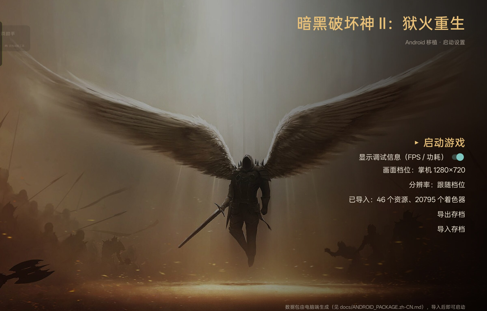
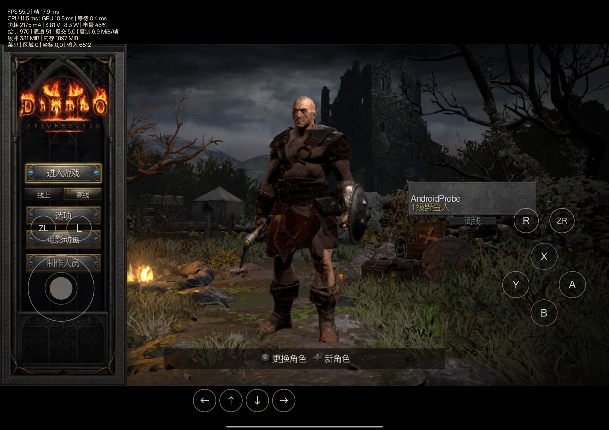
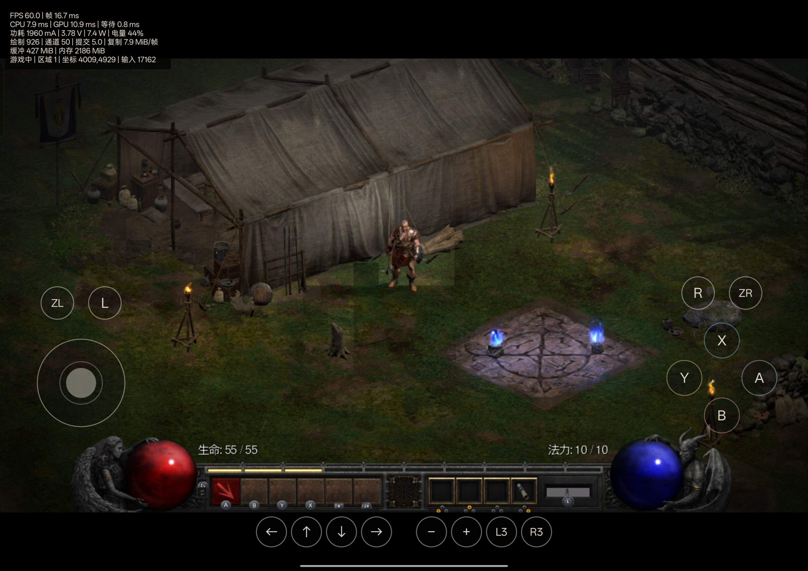

# D2R Android

把《暗黑破坏神 II：重制版》的**原版 ARM64 程序**直接跑在 Android 上的移植项目（NVN → Vulkan 渲染、AAudio 声音、触控与手柄），仓库只含宿主/移植代码与工具，**不含任何游戏内容**。

English: [README.md](README.md)

## 快速开始

**方式一：下载现成制品（推荐）**

在 [Releases](https://github.com/sydeEvans/d2r-android/releases) 下载两个文件（维护者推 `v*` tag 时由 CI 自动生成）：

1. `D2R-Android-port.apk` —— 手机端应用。**不含游戏数据**，数据靠下面的包导入。
2. `d2r-package-kit-<版本>.zip` —— 电脑端打包套件：源码（打包工具在里面）+ `d2r-package` 技能 + 上面那个 APK + 一页说明。

然后：

1. 把解压后的套件文件夹交给 AI 助手（Claude Code 等），说：**「用 d2r-package 技能帮我打包并装到手机」**。
2. 助手会读 `.claude/skills/d2r-package/SKILL.md`，引导你准备**你自己的**游戏文件（`.nsz` / `.nsp` / `.xci`）与 `prod.keys`，在本机生成数据包（一小时量级，之后可 `--reuse` 几分钟重做）。
3. 助手按技能里的「用 adb 直接装到手机」一节装 APK、把数据包推到手机；最后你在手机上点两下「导入数据包」→「启动游戏」即可开玩。

密钥与游戏文件全程只留在你自己的电脑上。

**方式二：自己构建（Linux x86_64）**

```bash
python3 dm/android/tools/bootstrap.py          # NDK / JDK / build-tools / platform（约 800 MB，只装一次）
python3 dm/android/tools/build.py --game-run   # 产出 dm/android/build/D2R-Android-port.apk（通用包）
python3 dm/android/tools/ci_checks.py          # 可选：跑与仓库 CI 相同的检查
```

想让 APK 自带游戏代码（不再依赖导入）需要先按[构建说明](docs/ANDROID_BUILD.zh-CN.md)从你自己的游戏文件生成模块，再给 `build.py` 加 `--game-source <目录>`。完整步骤见[Android 构建与部署](docs/ANDROID_BUILD.zh-CN.md)。

## 界面

实机截图（OPPO OPD2409 / Adreno 830）。游戏画面左上角是调试浮层的实时数字：帧率、帧时、CPU / GPU 耗时、功耗与绘制计数。

**启动界面** —— 数据包导入、画面档位、输出分辨率、存档导入 / 导出。启动界面是普通应用界面，没有帧率浮层：



**英雄选择** —— 从备份导入存档后，角色直接回来：



**营地** —— Act I 营地，实测 60.0 FPS / 帧时 16.7 ms：



## 项目进展（2026-10-17）

- 游戏本体的 ARM64 程序运行在 Android 宿主上，图形走 NVN → Vulkan；已具备 AAudio 声音、系统键盘命名、虚拟摇杆与按键、**手柄输入（含十字键与 ZL/ZR）**、FPS/CPU/GPU 调试浮层（默认关闭，可用游戏内菜单开）。
- **启动界面**：数据包导入、画面档位、输出分辨率（跟随档位 / 1080p / 1440p）、存档导入/导出。
- **游戏内菜单**（返回键呼出，照 Eden 的做法）：帧率显示、虚拟摇杆、画质（3D 内部分辨率四档，立即生效）、导出存档、导入存档、退出。放在屏幕边缘误滑不会再直接退出整局。
- **生命周期**：切后台会先请游戏存盘再挂起，回来保留进程并重建窗口/交换链继续玩；从桌面点图标回来直接回到游戏。
- **性能**：营地（OPD2409 / Adreno 830）平均约 60 FPS；151 个 120 帧窗口里 142 个没有超过 33 ms 的帧。跨启动管线预热已真机验证（127 条后台重建 447.7 ms，菜单处管线创建 826 ms → 1.1 ms）。剩余缺口集中在「首次踏入新区域时的一次性着色器编译」与偶发长帧。
- **尚未达到全场景稳定 60 FPS**，也不是完成全部验证的正式发行版。当前状态以[移植进度](docs/ANDROID_PORT_PROGRESS.zh-CN.md)为准。

## 文档

- [Android 移植进度（继续开发的入口，最权威）](docs/ANDROID_PORT_PROGRESS.zh-CN.md)
- [Android 构建与部署](docs/ANDROID_BUILD.zh-CN.md)
- [数据包格式与打包](docs/ANDROID_PACKAGE.zh-CN.md)
- [启动设置](docs/ANDROID_LAUNCH_SETTINGS.zh-CN.md)
- [冻结状态、实测范围与已知问题](docs/ANDROID_RELEASE_SNAPSHOT.zh-CN.md)
- [上游项目原始说明](docs/UPSTREAM_README.zh-CN.md)

## 依赖与来源

- **上游**：[jhaizhou-ops/d2r-mobile](https://github.com/jhaizhou-ops/d2r-mobile)（基线 `2eb5758771f110cd53082b999d88d242766610da`）。保留其 [MIT 许可](LICENSE) 及第三方许可声明。
- **优化参考**：Eden（Switch 模拟器，参考其渲染与超分做法；其着色器翻译是 GPL-3.0，**不并入**本 MIT 项目）与 LASRecomp。
- **随包分发的图形驱动**：[Turnip](https://gitlab.freedesktop.org/mesa/mesa)（Mesa 的开源 Vulkan 驱动，MIT 许可）—— T30 版 Adreno 构建，作者 **@Mr_Purple_666**（`vulkan.purple.so`，`26.3.0-T30-1.4.359`），原样放在 `dm/android/prebuilt/turnip/` 并附其 `meta.json`。启动界面也可以改用手机自带驱动。
- **构建依赖**：Android NDK r28c、JDK 17、Android SDK build-tools / platform 35（`bootstrap.py` 自动安装的版本为准）。
- **打包游戏数据另需**（只在玩家电脑上）：Python venv（`lz4` / `capstone` 等）、`hactool`、.NET 10 SDK；技能里的前置条件表逐项列出了它们。

**本仓库不包含**游戏程序、RomFS、密钥、存档、翻译后的游戏着色器或 APK。真实 APK 里的游戏模块与数据包都由玩家用**自己的**文件在本机生成，不随仓库或 Release 分发。

仓库**带一个第三方二进制**：**Turnip** 图形驱动（`dm/android/prebuilt/turnip/vulkan.purple.so`，Mesa，MIT 许可，T30 构建者为 **@Mr_Purple_666**），构建时会被打进 APK。启动界面可以在它和手机自带驱动之间切换。实测：手机自带的 Adreno 驱动会出现**人物周边的方块状光照**，Turnip 画面正常，两者帧率都在 60 上下。Turnip 需要 Android 11+（`minApi 30`）；游戏的着色器按 64 的子组尺寸构建，所以启动界面会把数据包里的 `host-subgroup-size.txt` 照抄进驱动配置。构建时加 `--no-turnip` 出不含驱动的包。详见[驱动说明](docs/ANDROID_GPU_DRIVER.zh-CN.md)。

CI（GitHub Actions）构建上面那个 APK 与套件，见[构建说明](docs/ANDROID_BUILD.zh-CN.md#自动流水线github-actions)。
