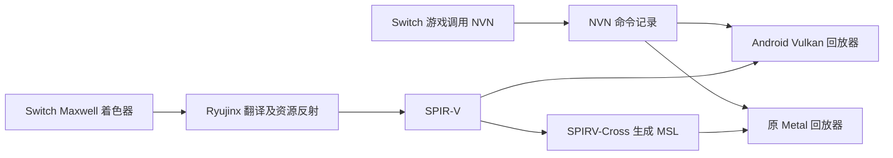

# Metal → Vulkan 开源实现调查及 D2R 借鉴方案

检索日期：2026-10-14。按用户要求，由独立智能体查阅项目官方仓库、文档和源码；研究不占用真机、不修改图形后端。

## 结论

**有真正同方向的开源实现，但本轮没有找到能够直接替换 d2r-mobile 原 Metal 后端、且已经验证 Android 完整游戏运行的成熟组件。** 最接近的是 Indium 和 MoltenMTL；前者包含编译后的 Metal 着色器翻译，后者要求直接提供 SPIR-V。两者均有明显的功能或平台限制。

对当前移植，更有价值的是借鉴 Dawn、wgpu、LLGL、bgfx 的 Vulkan 资源跟踪和命令生命周期，继续实现 **NVN → Vulkan**。黑光照需要追查实际输入、资源身份和计算结果；60 FPS 需要真机场景测量。接入一个翻译库并不能证明这两个问题得到解决。

## 先分清三个任务

| 任务 | 实际输入和输出 | 是否解决另外两项 |
| --- | --- | --- |
| 图形接口适配 | Metal/NVN 对象、状态、绘制与计算命令 → Vulkan 调用 | 不自动翻译着色器，也不自动解决客体内存同步 |
| 着色器翻译 | MSL 源码或 Apple AIR → SPIR-V | 不负责提交命令、贴图上传、资源绑定和显示 |
| 同一抽象的多个后端 | WebGPU/LLGL/bgfx 接口 → Metal 或 Vulkan | 需要应用改用该抽象，不是原 Metal 调用的自动替换 |

当前 D2R 原项目已经先通过 Ryujinx 将 Switch Maxwell 着色器翻译成 SPIR-V，再通过 SPIRV-Cross 生成 MSL；Android 直接使用前半条链输出的 SPIR-V。因此并不需要把原项目生成的 MSL 再逆向翻译回来。链路可在 [原图形层说明](../dm/gfx/README.zh-CN.md)、[原 NVN 映射](../dm/gfx/nvn_metal_mapping.zh-CN.md) 和 [Android 构建脚本](../dm/android/tools/build_shaders.py) 中核对。

## 真正同方向的候选

| 项目 | 实际方向 | 成熟度和限制 | 对本项目的用途 | 许可证 |
| --- | --- | --- | --- | --- |
| [Indium / Iridium](https://github.com/darlinghq/indium) | Metal 风格 C++ 接口 → Vulkan；Metal AIR → SPIR-V | 原 README 明确不是直接替换 Metal 的组件；要求 Vulkan 1.3 和时间线信号量。检出的主分支末次提交为 2023-04-11，源码仍有未实现路径 | 可参考命令完成回调、资源持有和 sampler 映射；不作为整体替换件 | [0BSD](https://github.com/darlinghq/indium/blob/8423a7d2f053167030d2bc4a227f96243c740667/LICENSE) |
| [MoltenMTL](https://github.com/Nishad-Sharma/MoltenMTL) | Swift 的 Metal 风格接口 → Vulkan，直接接受 SPIR-V | 开发中；作者只验证 Windows，Linux 计划中；单颜色附件、2D 纹理；argument buffer 为空实现；没有 MSL 翻译 | 可阅读轻量对象映射和 SPIRV-Reflect 绑定布局；D2R 使用多渲染目标及复杂纹理，直接接入会缺功能 | [Apache-2.0](https://github.com/Nishad-Sharma/MoltenMTL/blob/3cbd4a7e1f16a1973acc862a7892afd5ecc28f26/LICENSE) |
| [msl2glsl](https://github.com/gormlai/msl2glsl) | MSL 子集 → GLSL，再由 glslang 生成 SPIR-V | 源码转换工具；作者说明只覆盖接近 C 的 MSL 子集，主分支末次提交为 2022-01-14 | 可作为少量独立 MSL 工具核的辅助路径，不能替代渲染器；当前游戏着色器没有必要绕此路径 | [MIT](https://github.com/gormlai/msl2glsl/blob/cc91082b623741b859e642242e4258d9bbc90295/LICENSE) |
| [CrossTL](https://github.com/CrossGL/crosstl) | MSL 源码 → CrossGL 中间表示 → SPIR-V 汇编等 | 正在维护；官方支持矩阵区分支持、部分支持、诊断和拒绝。Vulkan 输出为 `.spvasm`，不是直接可加载的二进制；还需装配、验证和实际执行检查 | 可用于小规模 MSL 对照实验；不负责 Metal/NVN 主机调用、调度或资源生命周期 | [Apache-2.0](https://github.com/CrossGL/crosstl/blob/dd2940759c29640d6cdc58cc7a2bd53755624e35/LICENSE) |

### Indium：能参考什么，不能据名称推断什么

Indium 的 `src/indium/command-buffer.cpp` 在提交时保留自身和资源，使用时间线信号量完成序号，在真正完成后通知等待者并调用完成回调。这与原 D2R Metal 的完成回调模式同向，能帮助核对 Android 异步资源释放的结构。源码同时注明部分 encoder 的同步尚未补齐，完成回调也有已记录的问题，不能整段照搬作为正确性证明。[固定版本命令缓冲源码](https://github.com/darlinghq/indium/blob/8423a7d2f053167030d2bc4a227f96243c740667/src/indium/command-buffer.cpp)。

Iridium 的 `mtl2spv` 读取带 `MTLB` 文件头的 Metal 库，再解析 AIR/LLVM 内容；它不是 MSL 源码编译器。实际源码仍注明更复杂的控制流、函数调用及部分类型/纹理处理未完成。因此“存在 AIR → SPIR-V 工具”不等于“能转换 D2R 全套 metallib”。[CLI 输入格式](https://github.com/darlinghq/indium/blob/8423a7d2f053167030d2bc4a227f96243c740667/src/mtl2spv/mtl2spv.cpp)、[AIR 翻译实现](https://github.com/darlinghq/indium/blob/8423a7d2f053167030d2bc4a227f96243c740667/src/iridium/air.cpp)、[SPIR-V 构造器](https://github.com/darlinghq/indium/blob/8423a7d2f053167030d2bc4a227f96243c740667/src/iridium/spirv.cpp)。

### MoltenMTL：轻量，但缺口与 D2R 正好相关

可阅读 `Sources/MoltenMTL/Device+ComputePipeline.swift` 与 `Sources/CVulkan/spirv_reflect_bridge.c`，看如何从 SPIR-V 反射创建 descriptor layout；`CommandBuffer.swift` 明确将纹理、sampler、缓冲和管线持有到命令完成。不过当前析构仍可能阻塞等待，缺完成回调，并没有替本项目解决异步回收。[计算管线](https://github.com/Nishad-Sharma/MoltenMTL/blob/3cbd4a7e1f16a1973acc862a7892afd5ecc28f26/Sources/MoltenMTL/Device%2BComputePipeline.swift)、[命令资源持有](https://github.com/Nishad-Sharma/MoltenMTL/blob/3cbd4a7e1f16a1973acc862a7892afd5ecc28f26/Sources/MoltenMTL/CommandBuffer.swift)。

### MSL 源码转换的边界

msl2glsl 作者明确将 CPU 渲染代码留给应用实现。[作者的路线与限制](https://gormlai.github.io/blog/msl2glsl/)。CrossTL 当前源码已有工作组同步生成路径，不能拿早期 issue 断言今天仍然全部缺失；但它的支持矩阵明确不提供内置原生运行图执行器或 Vulkan 主机加载适配器。若用作对照，应固定版本、禁止忽略诊断，对选定着色器执行 `spirv-as` / `spirv-val`，再验证真实输出。[当前支持矩阵](https://github.com/CrossGL/crosstl/blob/dd2940759c29640d6cdc58cc7a2bd53755624e35/docs/source/support-matrix.rst)、[同步生成源码](https://github.com/CrossGL/crosstl/blob/dd2940759c29640d6cdc58cc7a2bd53755624e35/crosstl/translator/codegen/SPIRV_codegen.py)。

## 容易混淆的反方向项目

| 项目 | 已核实的方向 | 在本项目中的正确角色 |
| --- | --- | --- |
| [MoltenVK](https://github.com/KhronosGroup/MoltenVK) | Vulkan → Metal，内含 SPIR-V → MSL | 可阅读跨 API 语义映射；不能放进 Android 让 Metal 调用自动变为 Vulkan。许可证为 [Apache-2.0](https://github.com/KhronosGroup/MoltenVK/blob/main/LICENSE) |
| [SPIRV-Cross](https://github.com/KhronosGroup/SPIRV-Cross) | SPIR-V → MSL/GLSL/HLSL，并提供反射 | 原项目已经在用；可输出易读源码辅助比较，但不接受 MSL 作为输入。许可证为 [Apache-2.0](https://github.com/KhronosGroup/SPIRV-Cross/blob/300681bbcb8365a8d1eacdacdbdd0249bbf1d6b1/LICENSE) |
| [Naga](https://github.com/gfx-rs/wgpu/tree/trunk/naga) | WGSL/GLSL/SPIR-V 前端；MSL 为输出后端 | 可独立验证或查看 SPIR-V；官方输入列表没有 MSL。属于 wgpu 的 MIT/Apache-2.0 双许可体系。[输入/输出支持表](https://github.com/gfx-rs/wgpu/blob/60036cdc0ad979c96ec8277df41ec35b098502f6/naga/README.md) |

SPIRV-Cross 的旧 issue 曾回答没有已知 Metal → SPIR-V 编译器，但它是 2018 年的历史答复，不能用来否定今天的 Iridium、msl2glsl 或 CrossTL。[历史 issue](https://github.com/KhronosGroup/SPIRV-Cross/issues/650)。

## 更值得借鉴的成熟实现

这些是共用抽象的多个后端，不能直接接收原 Metal 调用。对 D2R 最有价值的是具体机制。

| 参考 | 具体代码入口 | 可借机制 | 对应当前移植 |
| --- | --- | --- | --- |
| [Dawn](https://github.com/google/dawn)，Chromium 的 WebGPU 实现，BSD-3-Clause | [`TextureVk.cpp`](https://github.com/google/dawn/blob/6c5a80a5ce3d175b1984078cab628206f6ee2b01/src/dawn/native/vulkan/TextureVk.cpp)：`CanReuseWithoutBarrier`、`TransitionUsageAndGetResourceBarrierImpl` | 按 mip、layer、aspect 跟踪访问及实际着色器阶段；保留写入→采样可见性，省掉已经满足条件的重复只读 barrier | 检查 LUT compute → tone-map 采样的阶段和子资源；descriptor 命中缓存仍需执行资源同步 |
| Dawn，BSD-3-Clause | [`QueueVk.cpp`](https://github.com/google/dawn/blob/6c5a80a5ce3d175b1984078cab628206f6ee2b01/src/dawn/native/vulkan/QueueVk.cpp)：`CheckAndUpdateCompletedSerials`；[`FencedDeleter.h`](https://github.com/google/dawn/blob/6c5a80a5ce3d175b1984078cab628206f6ee2b01/src/dawn/native/vulkan/FencedDeleter.h) | 在途 fence 按序号检查；只有真实完成之后才能回收资源 | 对照 Android 在途批次、客体写回和临时缓冲寿命，防止为了提速提前发布/复用 |
| Dawn，BSD-3-Clause | [`CommandBufferVk.cpp`](https://github.com/google/dawn/blob/6c5a80a5ce3d175b1984078cab628206f6ee2b01/src/dawn/native/vulkan/CommandBufferVk.cpp)：`DescriptorSetTracker::Apply` | 跟踪真正变化的绑定；管线布局变化时按兼容性重新绑定 | 减少每 draw 重复工作，保留不同管线/阶段的正确绑定 |
| [wgpu](https://github.com/gfx-rs/wgpu)，MIT/Apache-2.0 | [`wgpu-core/src/track/texture.rs`](https://github.com/gfx-rs/wgpu/blob/60036cdc0ad979c96ec8277df41ec35b098502f6/wgpu-core/src/track/texture.rs)；[`wgpu-hal/src/vulkan/command.rs`](https://github.com/gfx-rs/wgpu/blob/60036cdc0ad979c96ec8277df41ec35b098502f6/wgpu-hal/src/vulkan/command.rs)：`transition_textures` / `transition_buffers` | 先在统一层记录实际读写状态，再转换为 Vulkan 阶段、访问位和 layout；子资源状态有简单与复杂表示 | 为资源别名及局部子资源跟踪设计参考；不必把当前 C 回放器改写成 Rust |
| [LLGL](https://github.com/LukasBanana/LLGL)，BSD-3-Clause，官方列出 Android Vulkan | [`VKCommandBufferRing.cpp`](https://github.com/LukasBanana/LLGL/blob/62ea28e398f004559662265a497f3e17017b50d9/sources/Renderer/Vulkan/Command/VKCommandBufferRing.cpp)：`AcquireNextBuffer` | 环形命令缓冲，复用对应槽时才等待该槽 fence | 对照三个在途批次及独立 descriptor/UBO 池，不能所有批次复用一个尚在工作的池 |
| LLGL，BSD-3-Clause | [`VKCommandBuffer.cpp`](https://github.com/LukasBanana/LLGL/blob/62ea28e398f004559662265a497f3e17017b50d9/sources/Renderer/Vulkan/Command/VKCommandBuffer.cpp)；[`VKCommandContext.cpp`](https://github.com/LukasBanana/LLGL/blob/62ea28e398f004559662265a497f3e17017b50d9/sources/Renderer/Vulkan/Command/VKCommandContext.cpp)：`FlushBarriers` | 需要 copy 时暂停/恢复 render pass；聚合多条 barrier 再提交 | 减少同一 draw 的多次 Vulkan 调用；参考结构时仍要按实际 producer/consumer 阶段修正 |
| [bgfx](https://github.com/bkaradzic/bgfx)，BSD-2-Clause | [`src/renderer_vk.cpp`](https://github.com/bkaradzic/bgfx/blob/71539c41e7e782ccf30f19ae4498d25ddc7bc68c/src/renderer_vk.cpp) | 按在途帧分 descriptor/staging 池，复用 uniform scratch；缓存 pipeline/layout/renderpass/sampler/image view | 对照目前批次资源缓存和对象寿命；管线磁盘缓存有助加载卡顿，不能宣称它会直接把稳态帧率变成 60 |

Dawn 的只读复用条件还包括 shader stage：新增的读取阶段不能仅因图像已是“只读”就忽略同步。发生写入或布局变化后，之前已同步的读取阶段需要重置。当前 Android 按整个 image 保守记录，通常会增加等待；若追求细粒度优化，要先覆盖不同 mip/layer/aspect 的测试，而不是直接减少 barrier。

## 对黑光照与 60 FPS 的落地顺序

1. **保持同一 NVN 输入作为参照。** 逐项对照原 `nvn_mtl.m` 的 buffer 地址/偏移、贴图 serial/view、sampler、c0/c2 表与写回时机。绕成 Metal → Vulkan 会把这些已有的 NVN 问题包在额外一层里。
2. **采集黑画面的中间结果。** 检查 LUT 计算输出、HDR 场景输入、tone-map 输出的数值和资源身份。当前已有线索是 LUT compute `552f45c348a61b86` 的 image slot 4 与 tone-map `a1b1aab66933fa8f` 的 texture slot 11；这只是待验证路径，不能据此宣称根因已找到。
3. **独立核对 SPIR-V 资源声明。** [SPIRV-Reflect](https://github.com/KhronosGroup/SPIRV-Reflect) 可读 set/binding、descriptor 类型/数量、块成员布局和入口点资源，用作现有 `.res.json` 的交叉审计。它不能凭 SPIR-V 还原 NVN 客体槽、客体地址表或资源运行时身份，所以不替代 Ryujinx 反射。[官方能力说明](https://github.com/KhronosGroup/SPIRV-Reflect/blob/563dc9a16d0e86145e12a66bb61f0695ca4a14b9/README.md)；[Apache-2.0](https://github.com/KhronosGroup/SPIRV-Reflect/blob/563dc9a16d0e86145e12a66bb61f0695ca4a14b9/LICENSE)。
4. **按真实依赖做 GPU 内部传递。** compute 输出若下一步只由 GPU 读取，可保留 GPU 缓冲并设置写→读 barrier，避免回传 CPU 后再上传。CPU 要读、索引范围要解码、事件/计数器要发布时仍需真实完成；保留每次命令所见数据版本。
5. **按完成序号复用各批次资源。** 参考 Dawn/LLGL/bgfx，分别持有命令缓冲、descriptor、UBO、查询和临时资源；完成后回收，避免提交立即全等完。
6. **真机测量闭环。** 使用相同角色/场景、真实游戏 FPS、CPU 编码时间、GPU 时间和等待。图像恢复后再比较性能；没有运行 D2R 的小演示帧率不能作 60 FPS 的依据。

## 本轮证据与限制

- 已实际 clone 并阅读 Indium、MoltenMTL、msl2glsl、CrossTL；没有构建或运行这些候选，没有宣称 Android/D2R 已验证。检出的版本分别为 `8423a7d2f053167030d2bc4a227f96243c740667`、`3cbd4a7e1f16a1973acc862a7892afd5ecc28f26`、`cc91082b623741b859e642242e4258d9bbc90295`、`dd2940759c29640d6cdc58cc7a2bd53755624e35`。
- 本地只读研究副本在 `~/dm-work/research/{indium,MoltenMTL,msl2glsl,crosstl}`；固定版本 Dawn/wgpu/LLGL/bgfx 参考文件在 `~/dm-work/research/metal-vulkan-reference`。版本查询结果保存在 `~/dm-work/research/metal-vulkan-primary-revisions.json`。
- “成熟度”是依据平台声明、维护时间、功能缺口和源码作出的工程判断，不是官方认证。已有源码不保证在当前 Adreno 上性能或渲染正确。
- 网络还出现 Iron 的新实验线索，但本轮没有定位到可核验的作者源码与许可证，故没有把它列为可用实现，也不采信其完整支持声明。
- 此文完成调研与借鉴设计；实际黑光照修复、GPU 传递和 60 FPS 的进展继续记录在 [移植进度](ANDROID_PORT_PROGRESS.zh-CN.md)。
